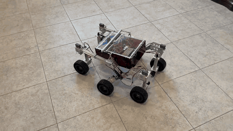

# Kasane Rover — Software

My build of NASA JPL's [Open Source Rover](https://github.com/nasa-jpl/osr-rover-code), running on a
**Raspberry Pi 5 · Ubuntu 24.04 · ROS 2 Jazzy**, driven with a **PS5 DualSense** controller.

Hardware build and modifications: [kasane-rover-hardware](https://github.com/elizaCelica/kasane-rover-hardware)



## What I changed

- **Unreliable I2C bus.** This rover's bus drops the first transaction after any idle period and can
  return zeroed data right after a failure. I tracked it down with `i2cdump` and kernel logs, settled on
  a 50 kHz bus, and made the servo and power-monitor nodes retry immediately and reject garbled readings.
- **Limp steering.** The corner servos received no position until the first steering command, and a
  dropped I2C write could leave them limp, so drive torque twisted the corners around. The servos now
  center at startup, every write is retried, and positions are refreshed twice a second.
- **Low-battery protection.** The power monitor warns below 12.8 V and powers off the Pi if the battery
  stays below 12.0 V (3.0 V/cell), after two LiPo packs were ruined by over-discharge.
- **Pi 5 / Ubuntu serial.** No `/dev/serial0` on Ubuntu; switched the RoboClaw link to `/dev/ttyAMA0` and
  freed the port from the login console.
- **Motor direction.** Added a per-motor `inverted_motors` setting for two reversed drive motors.
- **DualSense controls.** Hold L1 to drive (deadman), R1 for turbo; left stick drives, right stick steers,
  and left stick sideways spins in place, gradually, even if your thumb drifts up or down.
- **Boot service.** The rover starts on power-up: press the PS button and drive.
- **Upstream merge.** Merged NASA's 2026 refactor (split servo interface, shared kinematics) and carried
  these fixes onto it, fixing an undeclared `publish_transform` launch argument and an in-place rotation
  check that only triggered with a perfectly sideways stick.

Setup steps outside the ROS workspace are in [`pi_setup/`](pi_setup/README.md).


https://github.com/user-attachments/assets/b4edb673-6a59-47c4-974d-68372bda73e9


---

*The original Open Source Rover README follows.*

# JPL Open Source Rover Code

This repository contains the code that runs on the Raspberry Pi (RPi) to control the 
[JPL open source rover (osr)](https://github.com/nasa-jpl/open-source-rover).

The rover runs on ROS2 (tested on Foxy), and uses Python3.

## Internals & structure

Please refer to README files associated with each folder for insight in how components work and what they do. 
This is also the place to look when you have modifications on your rover that require the code or parameters to be
changed.

* The [ROS overview](ROS/README.md) gives an overview of the setup related to ROS and links to specific implementations such as how the drive and corner commands are being calculated

## Simulation

A `Dockerfile` is provided to build and run the ROS2 stack, including the
[Gazebo Classic simulation](ROS/osr_gazebo/README.md), without installing anything on your host
besides Docker.

```bash
docker build -t osr-rover-sim .
```

To run a node or launch file with a graphical window (e.g. Gazebo, RViz), the container needs
access to your display. The easiest way to get that without hand-rolling X11/GPU flags yourself is
[`rocker`](https://github.com/osrf/rocker), which wires up the right flags for you:

```bash
pip install rocker
rocker --nvidia runtime --x11 osr-rover-sim
```

Only include `--nvidia runtime` if your machine has an NVIDIA GPU; omit it otherwise.

Inside the container:

```bash
ros2 launch osr_gazebo empty_world.launch.py
```

## Setup

The setup directory contains tutorial files for getting everything setup and configured for running the rover code. You should proceed through them in the following order:

* [Raspberry Pi setup](setup/rpi.md)
* [Rover code bringup](setup/rover_bringup.md)
